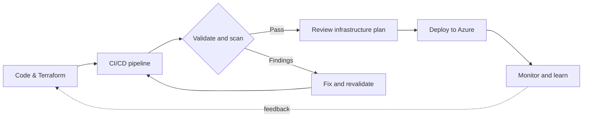

<div align="center">

# Vijay Shankar

### DevSecOps Engineer · Azure DevOps · Cloud Automation

**I build secure cloud foundations and delivery workflows that teams can trust.**

9 years in technology &nbsp;|&nbsp; 5 years in Azure DevOps

<p>
  <a href="https://www.linkedin.com/in/vijayshankarshaha"></a>
  <a href="mailto:vss141189@gmail.com">Email-D14836?style=for-the-badge&logo=gmail&logoColor=white" alt="Email"/></a>
  
</p>

</div>

---

## 💻 A little about how I work

```text
vijay@cloud-platform:~$ ./engineering-focus

  CLOUD       Azure, governance, networking, monitoring
  AUTOMATION  Terraform, reusable infrastructure, CI/CD
  SECURITY    Shift-left checks, safer configuration, secret scanning
  NEXT        AI agents, RAG, MCP — learning by building
```

I’m an Azure DevOps and DevSecOps engineer with **9 years in technology, including 5 years focused on Azure DevOps**. I enjoy turning cloud and delivery requirements into infrastructure and pipelines that are repeatable, understandable, and security-conscious.

I’m also exploring **AI agents, retrieval-augmented generation (RAG), and MCP**—and how they might support real-world cloud and security workflows. I’m sharing that learning openly as I build.

## ⚡ What I focus on

| Area | How I approach it |
| --- | --- |
| ☁️ Cloud platforms | Azure foundations, networking, governance, and observability |
| 🏗️ Infrastructure as code | Terraform, modular patterns, and Bicep |
| 🔄 Delivery automation | CI/CD workflows with Azure DevOps, GitHub Actions, Jenkins, and Harness |
| 🛡️ DevSecOps | Bring code, infrastructure, and secret checks into the delivery workflow |
| 🤖 Applied AI | Learn agent, RAG, and MCP patterns through practical experiments |

## 🏛️ Secure delivery, end to end

The diagram below represents the engineering workflow I focus on—not a claim that every stage is implemented in every project.



## 🧰 Tools I work with

**Cloud & infrastructure**


**CI/CD**


**Security & quality**


**Scripting, systems & monitoring**


## 🚀 Selected projects

| Project | Focus |
| --- | --- |
| [Azure Landing Zone with Terraform](https://github.com/Vijay141189/azure-landing-zone-terraform) | Azure landing-zone infrastructure as code |
| [Terraform Azure Landing Zone](https://github.com/Vijay141189/terraform-azure-landing-zone) | Terraform-based Azure landing-zone work |
| [Terraform Child Modules](https://github.com/Vijay141189/Terraform-Child-module) | Landing-zone code organized with reusable child modules |
| [Governance & Alerting](https://github.com/Vijay141189/New-project-with-alerting) | Terraform project focused on governance and alerting |
| [Real Estate Infrastructure](https://github.com/Vijay141189/Real-state-project) | Terraform infrastructure project |

These are learning and engineering projects; visit each repository for its code and implementation details. [Browse all repositories →](https://github.com/Vijay141189?tab=repositories)

## 🤖 Exploring AI for engineering

| Topic | What I’m learning |
| --- | --- |
| **AI agents** | How tool-using agents can support repeatable engineering tasks |
| **RAG** | Grounding generated answers in relevant, trusted information |
| **MCP** | Connecting AI applications with tools and context through a common protocol |

My aim is to explore these ideas responsibly and find practical ways they can complement cloud operations and secure delivery.

## 📊 GitHub at a glance

<div align="center">


</div>

## 📫 Let’s connect

Open to conversations about **Azure, DevSecOps, CI/CD, Terraform, and practical AI tooling**.

- 💼 [LinkedIn](https://www.linkedin.com/in/vijayshankarshaha)
- 📧 [Email](mailto:vss141189@gmail.com)

<div align="center">

*Secure the foundation. Automate the path. Keep learning.*

</div>
