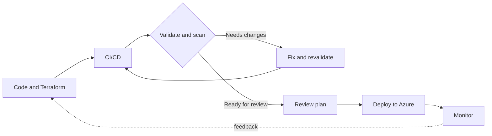

<div align="center">


<p>
  <a href="https://www.linkedin.com/in/vijayshankarshaha"></a>
  <a href="mailto:vss141189@gmail.com"></a>
</p>

<p>
  <a href="#about">About</a> &nbsp;·&nbsp;
  <a href="#focus">Focus</a> &nbsp;·&nbsp;
  <a href="#toolkit">Toolkit</a> &nbsp;·&nbsp;
  <a href="#projects">Projects</a> &nbsp;·&nbsp;
  <a href="#ai">AI learning</a> &nbsp;·&nbsp;
  <a href="#github">GitHub</a>
</p>

</div>

---

<a id="about"></a>
## 👋 About me

I’m **Vijay Shankar**, an Azure DevOps and DevSecOps engineer with **9 years in technology, including 5 years focused on Azure DevOps**. I enjoy building cloud infrastructure and delivery workflows that are repeatable, maintainable, and security-conscious.

My work and projects bring together **Azure, Terraform, CI/CD, and shift-left security**. I’m also learning how **AI agents, retrieval-augmented generation (RAG), and MCP** could be useful in real engineering workflows.

```text
vijay@cloud:~$ cat engineering-principles.txt
secure the foundation  →  automate the repeatable  →  keep learning
```

<a id="focus"></a>
## ⚡ What I focus on

| ☁️ Cloud & platform | 🏗️ Infrastructure as code | 🛡️ Secure delivery | 🤖 Exploring |
| --- | --- | --- | --- |
| Azure, networking, governance, monitoring | Terraform, reusable modules, Bicep | CI/CD checks for code, infrastructure, and secrets | AI agents, RAG, MCP |

### A secure delivery workflow

*An illustrative workflow—not a claim that every stage is deployed in every project.*



<a id="toolkit"></a>
## 🧰 Toolkit

**Cloud & infrastructure**


**CI/CD**


**Security & quality**


**Scripting, systems & monitoring**


<a id="projects"></a>
## 🚀 Selected projects

| Project | Focus |
| --- | --- |
| [Azure Landing Zone with Terraform](https://github.com/Vijay141189/azure-landing-zone-terraform) | Azure landing-zone infrastructure as code |
| [Terraform Azure Landing Zone](https://github.com/Vijay141189/terraform-azure-landing-zone) | Terraform-based Azure landing-zone work |
| [Terraform Child Modules](https://github.com/Vijay141189/Terraform-Child-module) | Landing-zone code organized with reusable modules |
| [Governance & Alerting](https://github.com/Vijay141189/New-project-with-alerting) | Terraform project focused on governance and alerting |
| [Real Estate Infrastructure](https://github.com/Vijay141189/Real-state-project) | Terraform infrastructure project |

These repositories show my hands-on engineering and learning. Visit each project for its implementation details.

<a id="ai"></a>
## 🤖 Exploring AI for engineering

```text
AI agents  →  learning how agents use tools to support engineering tasks
RAG        →  exploring how to ground answers in relevant knowledge
MCP        →  learning how AI applications connect to tools and context
```

I’m at the **exploration and learning stage** with these topics, and interested in practical, responsible applications for cloud operations and secure delivery.

<a id="github"></a>
## 📊 GitHub

<div align="center">


</div>

## 💬 Let’s connect

Interested in **Azure, Terraform, DevSecOps, CI/CD, or practical AI tooling**? I’d be happy to connect.

<div align="center">

<a href="https://www.linkedin.com/in/vijayshankarshaha"></a>
<a href="mailto:vss141189@gmail.com"></a>

*Build securely. Automate thoughtfully. Stay curious.*

</div>


